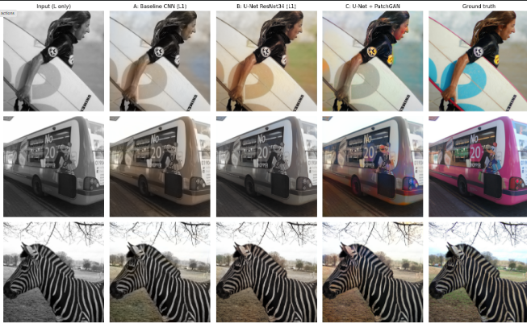
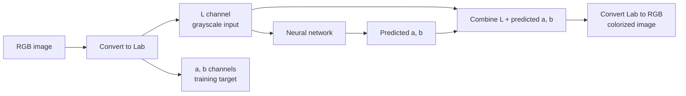

<div align="center">

# 🎨 Black & White Image Colorization with Deep Learning

**Turn grayscale photos into color using Lab color space, a ResNet-34 U-Net and a pix2pix-style GAN.**




<sub>Columns: grayscale input → baseline CNN → U-Net → U-Net + GAN → ground truth</sub>

</div>

---

## ✨ Overview

A grayscale photo has lost its color, and many colorings are equally valid: a car can be red or blue, a shirt can be any color. That makes colorization an **ill-posed problem**, and it is the reason the loss function matters so much.

This project builds a complete colorization pipeline and compares **three models** on the same data to understand what each design choice contributes:

| | Model | Loss | What it tests |
|---|---|---|---|
| **A** | Baseline encoder-decoder CNN | L1 | A plain regression baseline |
| **B** | U-Net with pretrained ResNet-34 encoder | L1 | Skip connections + transfer learning |
| **C** | Model B fine-tuned with a PatchGAN discriminator | L1 + adversarial | Does adversarial training give more vivid colors? |

---

## 🧠 How it works



**Why Lab color space?**
- **L** is lightness (the grayscale image) and **a / b** are the color axes (green↔red, blue↔yellow).
- The network only predicts **2 channels** instead of 3.
- The **original L channel is reused untouched**, so the structure and sharpness of the photo are never altered, only color is added.
- Lab is also closer to human perception than RGB.

**Normalisation:** `L → L/50 − 1`, `ab → ab/110`, so the network can end with a `tanh` layer.

---

## 🏗️ Architectures

**A · Baseline CNN**: four strided convolutions down, four upsampling convolutions up, no skip connections. Fine detail is lost through the bottleneck.

**B · U-Net with ResNet-34 encoder**
- ImageNet-pretrained ResNet-34 as the encoder, so the model already "knows" objects like sky, grass and faces.
- A 5-level decoder with **skip connections** that carry high-resolution detail, so colors stay inside object boundaries.
- The raw `L` channel is also fed into the last decoder stage to preserve fine detail.

**C · U-Net + PatchGAN (pix2pix-style)**
- The generator is model B; a **PatchGAN discriminator** judges whether each 70×70 patch of the `(L, ab)` image looks real or fake.
- Generator loss = adversarial loss + **100 × L1**. The L1 term keeps colors correct; the adversarial term pushes them to be sharp and saturated.
- Trained by fine-tuning from the trained model B (the standard "pre-train with L1, then add the adversarial loss" recipe).

---

## 📊 Results

Evaluated on a held-out test set. `Grayscale` means "predict no color" and is the reference point.

| Model | PSNR ↑ | SSIM ↑ | LPIPS ↓ | ab MAE ↓ | Colorfulness ↑ |
|---|:---:|:---:|:---:|:---:|:---:|
| Grayscale (no color) | 21.90 | 0.9098 | 0.2388 | 10.88 | 0.00 |
| A: Baseline CNN (L1) | 22.79 | 0.9132 | 0.2116 | 9.65 | 15.69 |
| **B: U-Net ResNet-34 (L1)** | **23.45** | **0.9165** | **0.1762** | **8.76** | 24.10 |
| C: U-Net + PatchGAN | 21.73 | 0.8812 | 0.1966 | 10.54 | **42.70** |

> **PSNR / SSIM**: fidelity to the one true image · **LPIPS**: learned perceptual distance · **ab MAE**: error in the color channels (Lab units) · **Colorfulness**: Hasler–Süsstrunk vividness measure

### 🔍 Key findings

1. **Skip connections + a pretrained encoder help (A → B).** The U-Net beats the baseline on every metric, with LPIPS dropping by about 17%.
2. **The GAN makes colors far more vivid (B → C).** Colorfulness rises from 24.1 to 42.7, countering the washed-out look of L1-trained models.
3. **...but pixel metrics drop, and that is expected.** L1 regression predicts the *average* of all plausible colors, a safe, desaturated guess that scores well on PSNR/SSIM. The GAN commits to a vivid color that may differ from the single ground truth, so PSNR/SSIM fall even though the result can look better. This is the ill-posed nature of the problem showing up in the numbers.
4. **PSNR and SSIM alone are not enough for colorization**, so this project also reports LPIPS and colorfulness and inspects results visually.

<details>
<summary><b>Training curves</b></summary>


</details>

---

## 🚀 Quick start

### Run in Google Colab (recommended)
1. Open `bw_image_colorization.ipynb` in Colab (use the badge above).
2. `Runtime → Change runtime type → T4 GPU`.
3. Set `SMOKE_TEST = True` in the config cell for a ~3 minute check that everything works, then set it to `False` and `Runtime → Run all` (roughly 30-45 minutes on a free T4).

Checkpoints are saved to Google Drive, so if Colab disconnects, re-running the notebook reloads finished models instead of retraining.

### What the notebook contains
- Data download and preprocessing (COCO images, grayscale photos filtered out)
- A GPU Lab ↔ RGB conversion, **verified against scikit-image**
- Models A, B and C with training loops
- Evaluation with PSNR, SSIM, LPIPS, ab MAE and colorfulness
- Side-by-side result grids and training curves
- A **Gradio web demo** that colorizes your own photos at full resolution

---

## ⚙️ Training details

| | |
|---|---|
| Data | ~4K COCO photos (color images only; the L channel is the input), train / val / test split |
| Resolution | 256 × 256 |
| Batch size | 16 |
| Models A, B | Adam, lr 2e-4, cosine schedule, L1 loss, 15 epochs, best validation epoch kept |
| Model C | Adam (β₁ = 0.5), G lr 1e-4, D lr 2e-4, λ_L1 = 100, 15 epochs |
| Augmentation | Random resized crop, horizontal flip |

---

## 🖼️ Try it on your own photos

The notebook ends with a Gradio app. Upload a black-and-white photo, choose a model, and get the colorized result. The network runs at 256×256, but your **original L channel is kept at full resolution** and only the predicted color is upsampled, so the output stays as sharp as your input.

<!-- Add a screenshot or GIF of the demo here: -->
<!--  -->

---

## ⚠️ Limitations

- Small training set (~4K images) and 256 px training resolution.
- Ambiguous objects (clothing, cars) can be colored plausibly but not "correctly".
- The GAN can over-saturate, and it trades pixel-metric scores for vividness.
- Evaluated with automatic metrics and visual inspection only, with no human preference study.

## 🔭 Future work

- Train on a larger, more diverse dataset (ImageNet / Places365).
- Classification over quantised color bins with class rebalancing (Zhang et al.), which tackles the "averaging" problem directly.
- Diffusion-based colorization with user control (e.g. Control Color).
- User hints or scribbles to guide the colors.
- FID on a larger sample and a human preference study.

---

## 📁 Repository structure

```
├── bw_image_colorization.ipynb   # full end-to-end project
├── assets/
│   ├── qualitative_results.png   # result grid (saved by the notebook)
│   ├── training_curves.png       # training curves (saved by the notebook)
│   └── demo.gif                  # optional demo recording
└── README.md
```

---

## 📚 References

- Isola et al., *Image-to-Image Translation with Conditional Adversarial Networks* (pix2pix), CVPR 2017
- Zhang, Isola, Efros, *Colorful Image Colorization*, ECCV 2016
- Ronneberger et al., *U-Net: Convolutional Networks for Biomedical Image Segmentation*, MICCAI 2015
- He et al., *Deep Residual Learning for Image Recognition* (ResNet), CVPR 2016
- Zhang et al., *The Unreasonable Effectiveness of Deep Features as a Perceptual Metric* (LPIPS), CVPR 2018
- Hasler & Süsstrunk, *Measuring Colourfulness in Natural Images*, 2003
- Lin et al., *Microsoft COCO: Common Objects in Context*, ECCV 2014

---

## 👤 Author

**Nimrat Kaur**: [GitHub](https://github.com/YOUR_USERNAME) · [LinkedIn](https://www.linkedin.com/in/YOUR_PROFILE)

⭐ If you found this project useful, consider starring the repository.
